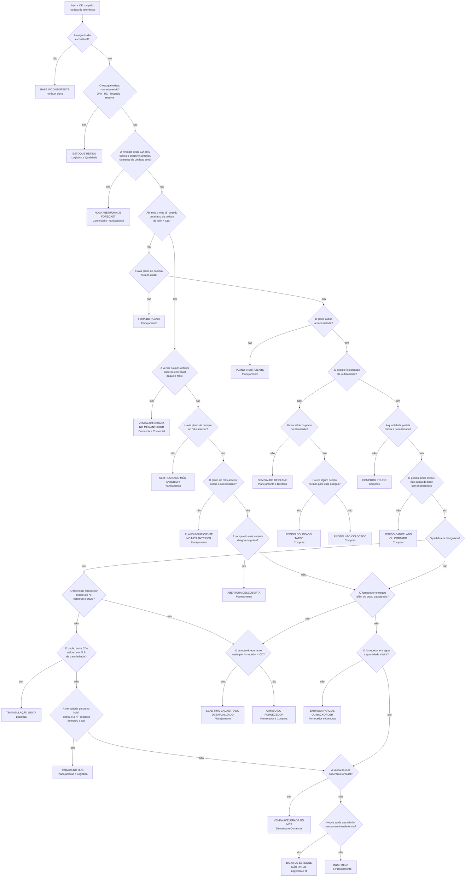
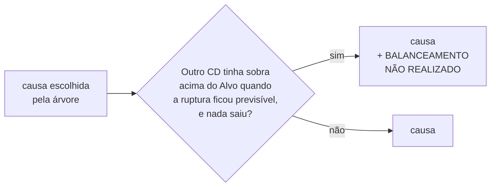

# Árvore de decisão — diagnóstico de ruptura

Classificação de cada posição **item × CD** rompida na data de referência.
Uma causa por caso, decidida em ordem: a primeira pergunta que responde "sim"
encerra a classificação.

Esta é a versão corrigida da árvore desenhada em 11/10/2026. O que mudou está
em [O que foi corrigido](#o-que-foi-corrigido), no fim.

---

## A árvore

### O modificador do balanceamento

A árvore desenhada repetia a dupla *"podia transferir? → realizou?"* em três
lugares, e foi justamente nos lugares onde ela **não** foi repetida que
apareceram ramos sem saída. Em vez de repeti-la pela quarta vez, ela vira um
**modificador aplicado depois**, sobre a causa já escolhida:

> Quando a ruptura ficou previsível, outro CD tinha sobra acima do **Alvo** e
> nenhuma transferência saiu?

Se sim, a causa recebe o sufixo **" + balanceamento não realizado"**.

Não se aplica a `BASE INCONSISTENTE` nem a `NOVA ABERTURA DE FORECAST`: na
primeira não há o que cobrar de ninguém, e na segunda não houve tempo material
para reagir.

O limite da "sobra" não é escolhido aqui. Vem do **Alvo** do Painel, o mesmo
parâmetro que a tela de sugestão de transferência usa — duas réguas para a
mesma pergunta acabariam dizendo que cabia transferência onde a outra tela
nunca sugeriu.

---

## As regras, nó por nó

| nó | pergunta | dado | limite |
|---|---|---|---|
| **D0** | carga confiável | `forecast.codigo` nulo em massa; fração de posições rompidas no dia | mais de 5% sem código, ou mais de 50% rompidas |
| **D1** | estoque retido | `est_arm_q40`, `est_arm_rc`, `bloqueio`, `reserva` | qualquer um acima de zero |
| **D2** | forecast novo | `forecast` contra **o snapshot imediatamente anterior** | `forecast_m0` era zero ou a linha não existia |
| **D3** | abertura descoberta | foto de abertura do `simulador` contra `forecast.politica` | disponível menor que consumo diário vezes política |
| **A1 / V1** | venda acelerada | `historico_vendas` contra `forecast_m0` | mais de 20% acima do previsto proporcional |
| **A2 / B1** | sem plano | `plano_compra` do mês | ausente ou zero |
| **A3 / B2** | plano insuficiente | plano contra necessidade | plano menor que 90% da necessidade |
| **B3** | pedido tarde | `pedidosDoCiclo`: menor `data_emissao` do mes contra a data limite | mais de 2 dias além do limite; sem pedido responde "não" |
| **B3a** | sem saldo de plano | `movimentoDoPlano` + `saldoEm` na data limite | saldo zerado ou negativo |
| **B3b** | pedido nao colocado | existe linha em `pedidos_de_compra` no mes | nenhuma linha emitida |
| **B4** | comprou pouco | `quantidade_total` contra necessidade | menor que 90% da necessidade |
| **B5** | pedido cancelado | pedido some entre snapshots sem recebimento | 107 linhas medidas na janela |
| **T1** | triangulado | `tp_ped_transf_descricao` | diferente de "N/A" |
| **T2** | trecho do fornecedor | `recebimento`: `data_emissao` menos `data_pedido` | mais de 2 dias além do p50 do par |
| **T3** | trecho entre CDs | `transferencias_abertas` contra `sla_transferencias` | mais de 1 dia útil além do SLA |
| **T4** | parada no hub | entrada no hub contra emissão da NF seguinte | mais de 2 dias |
| **F1** | prazo do fornecedor | `recebimento`: `data` menos `data_pedido`, contra `lead_time_fornecedor` | mais de 2 dias além do cadastrado |
| **F2** | recorrência | mediana real do par contra o cadastrado | mediana acima do cadastrado, com 6 ou mais entregas |
| **F3** | entrega parcial | `quantidade_entregue` contra `quantidade_total`; `bo` | abaixo de 100%, ou `bo` em B.O. |
| **V2** | baixa não usual | o balanço não fecha e não há venda nem transferência que explique | divergência acima de 10% |

**Necessidade** = consumo diário × (lead time + política) − disponível − o que
já vinha a caminho, na data do teste.

---

## O que foi corrigido

### 1. "Pedido colocado tarde" não tinha caixa

O nó *"os pedidos foram colocados com tempo hábil?"* só tinha o ramo **sim**
desenhado. O **não** — uma das causas mais acionáveis e mais cobráveis — não
levava a lugar nenhum. Agora leva, e antes dele entra a pergunta do saldo: se
na data limite não havia verba no plano, o atraso é de planejamento e não de
compras.

### 2. "Comprou pouco" não existia

A árvore perguntava se *havia plano* e se o pedido *saiu a tempo*, nunca se a
**quantidade pedida bastava**. Um pedido no prazo, dentro do plano, mas pequeno
demais, descia até "Indefinida". Virou o nó **B4**.

### 3. Contradição no ramo do fornecedor

O desenho tinha:

> *"entrega do fornecedor maior que a média?"* → **sim** → atraso do fornecedor
>
> …e logo abaixo *"era triangulado?"* → **não** → **atraso do fornecedor** de novo

Chegar ao segundo nó significa que o fornecedor **não** passou da média. Não
pode ser atraso dele.

A ordem foi invertida: primeiro se pergunta **se era triangulado**, e só então
o tempo é decomposto. Isso ficou possível porque as três datas de
`recebimento` separam os trechos — conferido contra a própria coluna
`lead_time` da tabela, que bate com `data` menos `data_pedido` em 100% das
20.231 linhas:

| coluna | significado | trecho |
|---|---|---|
| `data_pedido` | colocação do pedido | início do prazo |
| `data_emissao` | emissão da NF pelo fornecedor | fim do trecho do fornecedor |
| `data` | entrada no CD | fim do prazo |

E o atraso passou a distinguir **dono**: estouro recorrente no par fornecedor ×
CD não é atraso, é cadastro errado — e o cadastro alimenta toda data limite de
compra do sistema. Medido: **56% dos 228 pares** têm o prazo cadastrado abaixo
da mediana real, com casos de 4 dias cadastrados contra 35 cumpridos.

### 4. Perguntas compostas, cujo "não" era ambíguo

> *"Iniciamos o mês anterior com estoque abaixo de 30 dias Cia **e** não tivemos plano de compras?"*

O "não" cobria três situações com ações opostas: tinha estoque, tinha plano, ou
tinha os dois. Foi quebrada em **A1 → A2 → A3 → A4**. O mesmo valia para
*"recebemos as quantidades compradas, **mas** as vendas aceleraram?"*, agora
separada em **B4** e **V1**.

### 5. Ramos "não" que não existiam

*"Tivemos plano no mês anterior mas as vendas aceleraram demais?"* não tinha
saída para o **não** — tínhamos plano, a venda foi normal, e mesmo assim o mês
abriu rompido. Agora desce para **A3** e **A4**.

### 6. "30 dias Cia" briga com a política por CD

A ruptura é **por CD**, mas a pergunta era em **Cia** e com número fixo. O
sistema já tem `politica` por item × CD — e **5.152 de 15.719** posições têm
política diferente de 30. O nó **D3** passou a usar a política do próprio item
× CD.

### 7. Estoque retido não aparecia

Q40, RC, bloqueio e reserva caíam em "Indefinida". São **11%** das posições
rompidas com saldo em Q40/RC. Viraram o nó **D1**, logo no começo, porque são
uma resposta de natureza diferente: o estoque **está lá**.

### 8. Acrescentados

**Base inconsistente** como primeira trava. Em 26/08/2026 uma carga de forecast
veio com 16.178 códigos nulos; sem essa trava o motor apontaria 6.168 rupturas
inexistentes, todas com confiança alta.

**Pedido cancelado ou cortado**. Entre snapshots consecutivos, 667 linhas de
pedido desaparecem e **107 não têm recebimento correspondente**. Nenhuma causa
cobria isso, e só é detectável porque a base é cumulativa.

### 10. Falta de dado nao acusa ninguem

Descoberto ao rodar a arvore nos 458 eventos de setembro. A primeira versao do
caminhante tratava "sem dado" como "nao" e seguia o ramo: a carga de
`plano_compra` de agosto perdeu os codigos num reimport de Produtos, a pergunta
A2 ficou sem resposta em **196 dos 458 eventos**, e a arvore devolvia **"sem
plano no mes anterior" em 44,5% dos casos** — uma acusacao a Planejamento
construida sobre um dado que nao existe.

Agora o percurso **para** no no sem dado e devolve `indefinida`, com a trilha
registrando qual pergunta travou. A tela consegue dizer "208 casos pararam em
A2 porque falta a carga de plano de agosto", que e uma tarefa de dados, nao um
veredito.

A distincao que importa: **ausencia de fato nao e ausencia de dado**. B3
responde "nao" quando nenhum pedido foi emitido no mes, porque
`pedidos_de_compra` traz todo o aberto do snapshot e o silencio ali e
informacao. Antes esse caso devolvia "sem dado" e 28 posicoes desciam para a
pergunta da data limite sem nunca ter havido data de emissao para comparar.

### 11. "Pedido colocado tarde" sobre posicao sem pedido

O no **B3b** nasceu dessa medicao: dos casos que chegavam a `pedido_tarde`,
parte nao tinha pedido nenhum. Sao cobrancas diferentes — atraso de prazo e
compra que nao aconteceu — e a frase "pedido colocado tarde" sobre uma posicao
sem pedido e simplesmente falsa. B3b separa as duas depois de B3a confirmar que
havia saldo.

### 9. Mantidos do desenho original

**"Saída de estoque não usual"** e **"Indefinida"** como terminal explícito.
São as duas melhores ideias da árvore: a primeira nomeia um caso que o motor
hoje só marca como "o balanço não fecha", e a segunda é mais honesta que
distribuir o resíduo entre causas conhecidas.

---

## Como isto se relaciona com o motor já construído

O motor em `src/lib/diagnostico-ruptura/` decide por **contrafactual**: mede
quantos dias de ruptura sumiriam se cada etapa tivesse funcionado, e só credita
a causa que de fato reduz os dias. Ele devolve **várias** causas com percentual.

A árvore devolve **uma**. As duas respondem perguntas diferentes e não se
anulam:

| | árvore | motor |
|---|---|---|
| resultado | uma causa | várias, com dias e percentual |
| como decide | ordem das perguntas | o conserto reduz os dias? |
| força | qualquer pessoa segue o fluxo | não credita regra que não causou nada |
| fraqueza | pode atribuir causa que não mudaria nada | precisa confiar na conta |

A ordem da árvore já faz parte do trabalho do contrafactual — ela só chega ao
nó da aceleração de venda depois de confirmar que havia plano e que a compra
chegou. É um contrafactual embutido na sequência: mais grosseiro, muito mais
legível.

O caminho barato para decidir entre as duas é **classificar os mesmos eventos
pelos dois métodos e olhar onde discordam**. As discordâncias são exatamente os
casos que valem conferir à mão.
